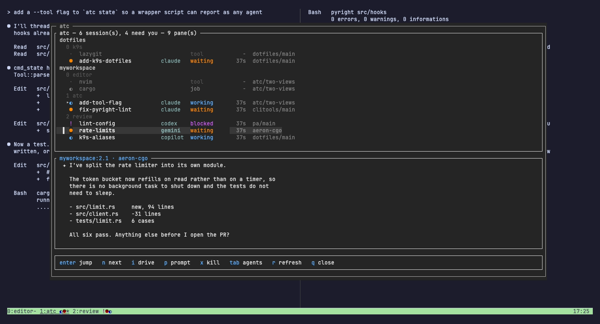

<div align="center">

# atc

**Air traffic control for your AI coding sessions.**

One status row and one keystroke for every agent running in every tmux pane —
what it's doing, how long it's been doing it, and what it last said.


</div>

---

Run six agents across tmux panes and you lose them. One has stopped and is
waiting for a reply, one is blocked on a permission prompt it asked for four
minutes ago, and the rest are still working — but the only way to find out is
to cycle through every pane and look.

`atc` puts that on your status bar, and the whole fleet behind `prefix + a`.

It works with **claude, codex, gemini and copilot**, driven by each one's own
hooks. No daemon, and no wrapper around your agents.

## The row


That's tmux's own window list. atc adds one glyph per AI pane *inside* each
window name, so tmux keeps its flags and its current-window highlight and
nothing on your bar moves. The glyphs come from a window option the hooks
write, so nothing is computed per redraw.

Above the row is an ordinary working window — nvim on the left, a build on the
right. Nothing resizes, nothing is replaced. That is the whole point:
`0:editor* 1:atc ◐● 2:review !●◐` tells you window 1 has one session working
and one waiting, and window 2 has one blocked, without you leaving the file
you're in.

Colour is on by default. For shape and weight only:

```sh
set -g @atc_colour off
```


Worth having bound if you want to flip it while looking at the bar:

```sh
bind-key A if-shell -F '#{==:#{@atc_colour},off}' \
  'set -g @atc_colour on' 'set -g @atc_colour off'
```

## The command center

`prefix + a` opens it over the top of your layout. Nothing resizes, and `q`
dismisses it.


It holds **two lists**, and `tab` swaps between them. They answer different
questions, which is why neither is the other with a filter on it.

The **agent list** is what opens, because clearing approvals is why you
pressed the key. Every AI session, flat, worst first — blocked at the top,
working at the bottom — and nothing else at all. No headings to scroll past,
no editors, no shells, no subagents: every line is somewhere `n` can stop and
`i` can drive. You come in, clear what is waiting, and leave.

The **tree** is the map of your workspace, in the order tmux itself holds it:
sessions by name, windows by index, panes where they sit on screen. Nothing
reorders, ever, so a pane is always where you last saw it — which is what you
want when you are navigating rather than triaging. Editors, shells and running
jobs are all in it, because the popup is also how you get back to `nvim` or
`k9s`.



| Column | |
|---|---|
| glyph | its state, same as the row |
| title | what the session is working on, as the agent reported it |
| tool | which of the four it is |
| time | how long it has been in that state |
| right | the repo and branch it's sitting in |

The bottom half is the **live screen of the selected pane**, so you can read
what a session actually said and answer it with `p` without going there.
Everything is jumpable, so the popup is also how you get back to the `nvim` or
`k9s` pane.

`i` goes further and **drives** the selected pane: every key you press from
then on goes to it, so an approval gets answered — arrows, a digit, `y`,
`enter` — while you watch the screen below. `esc` hands the keyboard back.
Nothing about the agents' prompts is hardcoded, so this works the same for all
four, and the preview tightens to 150ms while you're driving or sitting on a
blocked session so a keypress never looks dead.

The one key that doesn't reach the pane is **`esc`**, because that is the way
out. To interrupt a session while driving it press `ctrl-c`, which arrives as
the interrupt a terminal already sends. The footer names both while you're in
there, so nothing about this has to be remembered.

The cursor opens on whatever most needs you, and `n` walks to the next session
that does — blocked, waiting or errored, wrapping round, `N` to go back. So
clearing three approvals is `n` `i` answer `esc`, three times, with no
hunting. It's the same count the title reports, so `2 need you` means `n`
visits two.

Driving holds **the pane you chose**, not whatever the cursor is on. The agent
list rebuilds every second and a session going blocked floats it up the list
while you're mid-approval, so the selection is anchored to its pane and
nothing can redirect a keystroke to a session you didn't pick. `tab` keeps
hold of it too; when the list you land in has no row for it — a shell has none
in the agent list — the cursor takes whatever most wants you instead.

`enter` jumps. The window behind the popup changes with you:


`⑂` rows are the subagents running under a session, with how long each has
been going. They live in the tree, where the question is what is going on.
They aren't panes, so `j`/`k` step over them and `enter`, `p` and `x` never
land on one — which is also why the agent list leaves them out entirely.

## States

| Glyph | State | Set by |
|---|---|---|
| `●` | waiting — finished, wants a reply | `Stop` |
| `◐` | working | `UserPromptSubmit`, `PreToolUse`, `PostToolUse` |
| `!` | blocked — needs an approval | `PermissionRequest` |
| `✗` | error | `StopFailure`, `PostToolUseFailure` |
| `·` | idle — registered, nothing pending | `SessionStart` |

Bold means you've been ignoring it for a minute (`Notification`). Visiting the
pane clears the bold; the glyph itself stays until the session gets a reply.

`Notification` is deliberately **not** the primary signal: its
`permission_prompt` matcher fires ~6s after the prompt appears and
`idle_prompt` ~60s after the session goes quiet. `Stop` and `PermissionRequest`
fire immediately, so they drive state and `Notification` only escalates.

## What it knows about

The pane list comes from tmux and hook state is laid over it, so every pane is
accounted for — not just the ones that have reported:

| Kind | What it is | On the row |
|---|---|---|
| `session` | an AI session with hook state | its state glyph |
| `unreported` | looks like an AI session but has never fired a hook | `?` |
| `tool` | a long-lived TUI: `nvim`, `k9s`, `tredis`, `lazygit`, `htop`… | only with `--all` |
| `shell` | an idle shell | only with `--all` |
| `job` | a foreground command in a shell pane: `cargo`, `pytest`… | only with `--all` |

`unreported` matters: a session started before `atc` was installed has no
state, and silently omitting it would hide a session that is genuinely waiting
for you. It resolves itself on that session's next activity.

`job` costs nothing to detect — a shell pane whose running command is no longer
a shell has a job in it, and when it goes back to a shell the job is done. That
gives you progress on non-AI work with no instrumentation at all. `tool` exists
so `k9s` and `nvim` don't read as jobs that never finish.

Non-AI panes stay **off** the row by default. The row exists to show which
session needs you, and a glyph for every shell would bury that.

## The agents it knows

Four, and each keeps its hooks somewhere different. `atc install --tool <name>`
prints the right block for one of them.

| Agent | Hook config |
|---|---|
| `claude` | `~/.claude/settings.json` → `hooks` |
| `codex` | `~/.codex/config.toml` → `[hooks]` |
| `gemini` | `~/.gemini/settings.json` → `hooks` |
| `copilot` | `~/.copilot/hooks/atc.json` |

Hooks are the whole mechanism and cover every state for all four. atc never
reads a pane's screen to work out how a session is doing: a session says what
it is doing, or atc says it does not know.

Two gotchas worth knowing, both of which make a hook silently never run: gemini
only runs hooks in folders you have **trusted**, and codex ignores a
project-local `.codex/config.toml` unless the project is trusted.

One more, for copilot: its `permissionRequest` fires *before* it decides
anything, so it arrives for every tool call including the ones it goes on to
allow by itself. atc ignores it and reads copilot's `notification` instead,
which is the event that means it is really asking you. If you registered atc's
copilot hooks before this, re-run `atc install --tool copilot` to pick that up.

`atc doctor` is built for that failure. It **parses** each installed agent's own
config rather than searching it for text, because a handler registered at the
wrong depth is read without complaint and never runs — on paper it looks exactly
like one that works. It also reports how many panes have actually reported
through each agent, so "configured" and "working" stay separate claims.

## Sessions that never reported

A session that started before atc was watching has fired no hook, so there's
nothing on disk for it, and it shows as unknown until it fires one. atc used to
guess from the pane's screen by matching strings an agent's interface happens to
print. Those strings are not a contract: three of the four agents' were quoted
from source and never run, a marker only matched on one line so a narrow pane
read as unknown anyway, and a wrong guess is worse than no answer. It's gone.

For Claude a tool call fires a hook, so an unseen session identifies itself
within seconds of doing anything. One sitting idle stays unknown until you
touch it, which is the honest answer. `atc state <status>` sets one by hand.

## How it works

No daemon, and nothing watches a session that has reported — it speaks when
something happens to it.

- Hooks run as subprocesses that inherit the session's environment, so
  `$TMUX_PANE` identifies which pane fired the event. That's the whole
  mechanism for knowing what every session is doing.
- An agent rarely reports its own name to tmux. Claude's binary is named after
  its version (`2.1.308`), and gemini and copilot are npm packages, so they run
  as `node`. A pane running an interpreter is identified by the script it was
  handed — only the script, never the arguments after it, so
  `node build.js --out gemini.txt` stays an ordinary job.
- State lives in `~/.local/state/atc/panes/` as one small JSON file per pane,
  written atomically. `ATC_STATE_DIR` overrides it.
- The hook also writes tmux user options — `@atc_state` on the pane and an
  aggregate `@atc_win` on its window — which the status format reads directly,
  so window glyphs cost nothing to draw.
- Every hook ends with `refresh-client -S`, so the bar updates the instant a
  session stops rather than on the next status interval.
- The row reconciles against `tmux list-panes` on every render, so a killed
  pane can't leave a ghost glyph behind. A pane that outlives the agent in it
  can't either: state is only believed while the pane could still be running
  the thing that wrote it, so an agent that exits without firing its last hook
  leaves a shell, not a session. The file is left alone rather than deleted,
  because a pane briefly reports a pager the agent opened and a glyph that
  comes back on its own beats state thrown away for good.
- Nothing is read off a pane to work out its state, so a redraw captures no
  screens at all however big the fleet is. The popup's preview is the only
  place a pane's screen is read, and only for the one pane you have selected.

## Install

Needs tmux 3.0+ (tested on 3.7) and Rust.

```sh
git clone https://github.com/CMullaney01/atc ~/dev/atc
cd ~/dev/atc
cargo build --release
ln -sfn "$PWD/target/release/atc" ~/.local/bin/atc   # anywhere on PATH

# tmux: source the config, or paste it into your own tmux.conf
echo 'source-file ~/dev/atc/tmux/atc.conf' >> ~/.tmux.conf
tmux source-file ~/.tmux.conf

# agents: print the hook config for all four, or just one
atc install                   # tmux config + every agent
atc install --tool codex      # one agent, no tmux config
atc doctor
```

`atc` must be on the **tmux server's** PATH, which it inherits from wherever
the server was started. `atc doctor` will tell you if it isn't.

## Commands

| Command | Purpose |
|---|---|
| `atc hook <Event> [--tool <agent>] [--kind <matcher>]` | Apply a hook event (reads JSON on stdin) |
| `atc bar [session] [--all]` | Render the fleet row; `--all` includes non-AI panes |
| `atc status [--json]` | Report every tracked session |
| `atc ui` | Open the command center |
| `atc sync` | Refresh every window's glyphs (tmux runs this each redraw) |
| `atc state <status> [--title <t>]` | Report state for the current pane by hand |
| `atc seen <pane-id>` | Drop a pane's escalation flag |
| `atc ask <question>` | Ask Claude about the fleet |
| `atc doctor` | Check the installation |
| `atc install [--tool <agent>]` | Print the tmux and hook configuration |

## Anything else

`atc state` is the generic entry point, so any tool or long-running job can
report in:

```sh
atc state working --title "cargo bench"
cargo bench
atc state waiting
```

`atc status --json` exposes the whole fleet, which is also how a "manager"
session can reason about it:

```sh
atc ask "which session has been waiting longest, and what did it last say?"
```

## The screenshots

Everything above is a real tmux session, and `docs/demo/` rebuilds that fleet
and re-records the lot:

```sh
brew install vhs
vhs docs/demo/hero.tape    # the GIF and the command-center stills
vhs docs/demo/row.tape     # the status row, colour and mono
```

It runs on its own tmux socket and its own `ATC_STATE_DIR`, so recording can't
disturb a live session — and a live session can't disturb the recording.

Worth being exact about what is real in those pictures, since it is the whole
basis for believing them. **Every glyph comes from a hook.** Each demo pane
calls `atc hook` the same way the agent itself would, through the same code,
and staging fails rather than records if six agents do not report. The
editor, the git TUI and the cold `cargo build` are genuinely those things, and
each agent pane runs a process named the way that agent names itself, so the
rows are detected rather than declared.

What stands in: an agent's **screen** is a transcript in `docs/demo/screens/`,
and behind it sits a program that does nothing but stay alive. Running four
real agents to the same point on every take is not reproducible, and a picture
of a fleet has to be.

## Licence

MIT
