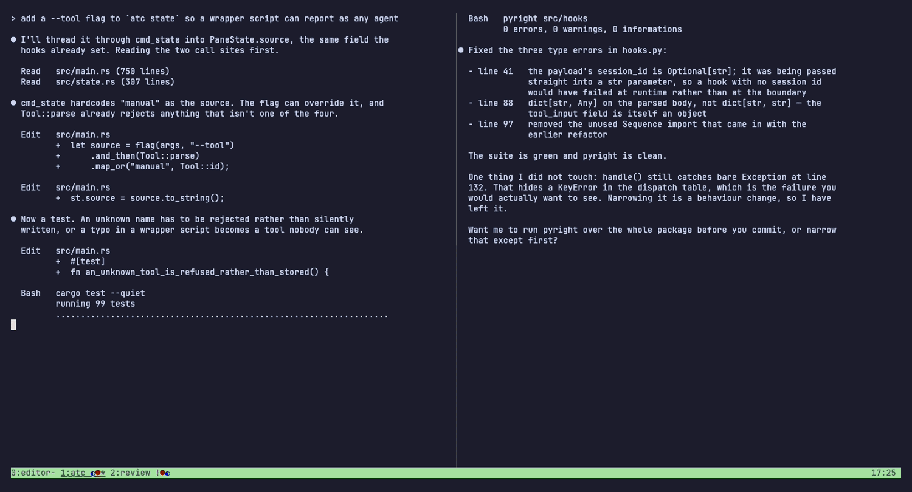
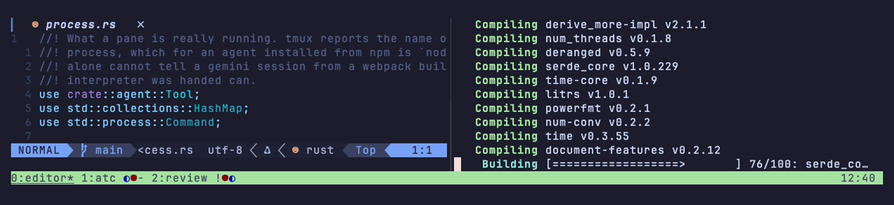
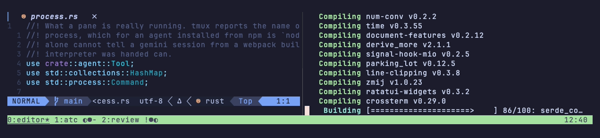
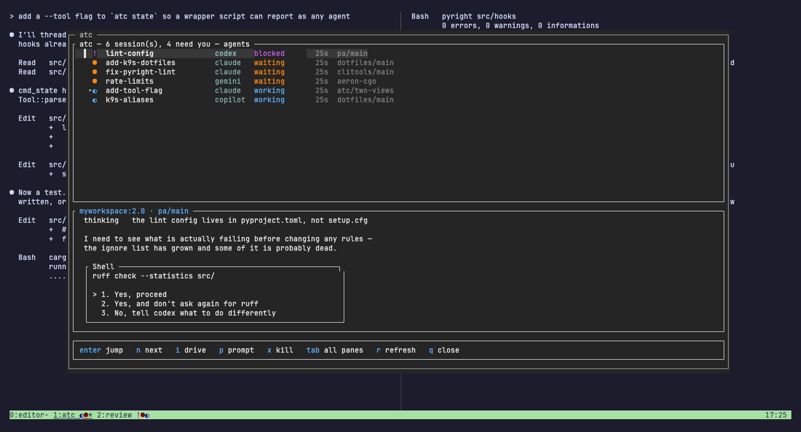
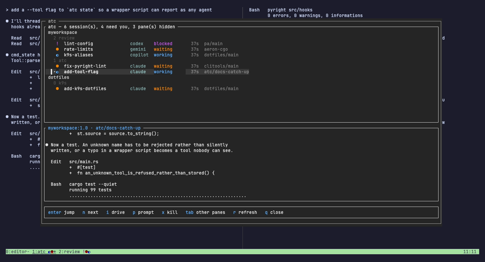
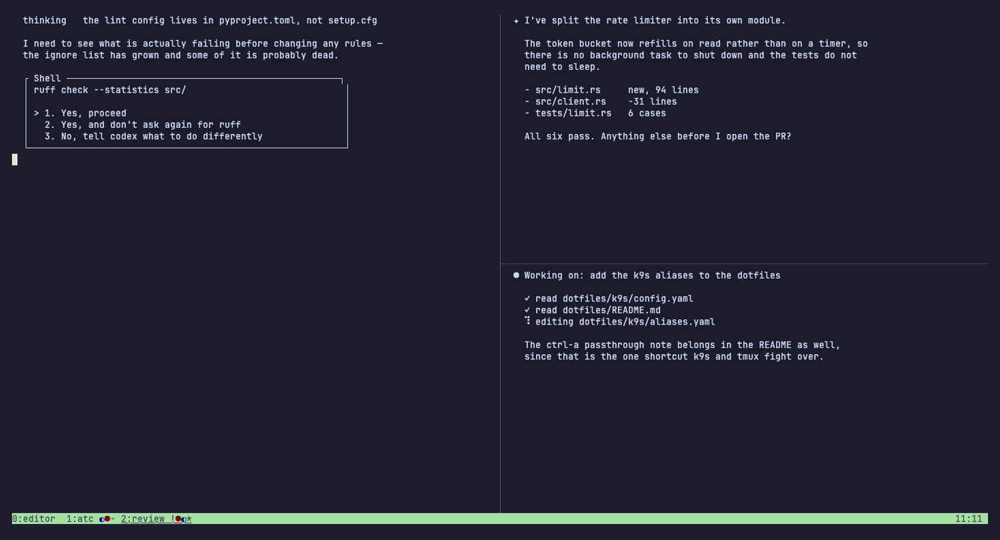

<div align="center">

# atc

**Air traffic control for your AI coding sessions.**

One status row and one keystroke for every agent running in every tmux pane —
what it's doing, how long it's been doing it, and what it last said.



</div>

---

Run six agents across tmux panes and you lose them. One has stopped and is
waiting for a reply, one is blocked on a permission prompt it asked for four
minutes ago, and the rest are still working — but the only way to find out is
to cycle through every pane and look.

`atc` puts that on your status bar, and the whole fleet behind `prefix + a`.

It works with **claude, codex, gemini and copilot**, driven by each one's own
hooks. No daemon, and no wrapper around your agents.

## The row



That's tmux's own window list. atc adds one glyph per AI pane *inside* each
window name, so tmux keeps its flags and its current-window highlight and
nothing on your bar moves. The glyphs come from a window option the hooks
write, so nothing is computed per redraw.

Above the row is an ordinary working window — nvim on the left, a build on the
right. Nothing resizes, nothing is replaced. That is the whole point:
`0:editor* 1:atc ◐● 2:review !●◐` tells you window 1 has one session working
and one waiting, and window 2 has one blocked, without you leaving the file
you're in.

Colour is on by default. For shape and weight only:

```sh
set -g @atc_colour off
```



Worth having bound if you want to flip it while looking at the bar:

```sh
bind-key A if-shell -F '#{==:#{@atc_colour},off}' \
  'set -g @atc_colour on' 'set -g @atc_colour off'
```

## The command center

`prefix + a` opens it over the top of your layout. Nothing resizes, and `q`
dismisses it.



Grouped the way your tmux actually is — session, then window, then the panes
in it — so a session always appears next to whatever it shares a window with
and you can see which terminal belongs to what. Windows lead with whatever is
most urgent, and the session you're attached to comes first, so the thing that
wants you still rises to the top.

| Column | |
|---|---|
| glyph | its state, same as the row |
| title | what the session is working on, as the agent reported it |
| tool | which of the four it is |
| time | how long it has been in that state |
| right | the repo and branch it's sitting in |

The bottom half is the **live screen of the selected pane**, so you can read
what a session actually said and answer it with `p` without going there.
Everything is jumpable, so the popup is also how you get back to the `nvim` or
`k9s` pane.

Non-AI panes — editors, shells, running jobs — are listed too, because the
popup is where you go to navigate. `tab` drops them when you only care about
the fleet:



`enter` jumps. The window behind the popup changes with you:



`⑂` rows are the subagents running under a session, with how long each has
been going. They aren't panes, so `j`/`k` step over them and `enter`, `p` and
`x` never land on one.

## States

| Glyph | State | Set by |
|---|---|---|
| `●` | waiting — finished, wants a reply | `Stop` |
| `◐` | working | `UserPromptSubmit`, `PreToolUse`, `PostToolUse` |
| `!` | blocked — needs an approval | `PermissionRequest` |
| `✗` | error | `StopFailure`, `PostToolUseFailure` |
| `·` | idle — registered, nothing pending | `SessionStart` |

Bold means you've been ignoring it for a minute (`Notification`). Visiting the
pane clears the bold; the glyph itself stays until the session gets a reply.

`Notification` is deliberately **not** the primary signal: its
`permission_prompt` matcher fires ~6s after the prompt appears and
`idle_prompt` ~60s after the session goes quiet. `Stop` and `PermissionRequest`
fire immediately, so they drive state and `Notification` only escalates.

## What it knows about

The pane list comes from tmux and hook state is laid over it, so every pane is
accounted for — not just the ones that have reported:

| Kind | What it is | On the row |
|---|---|---|
| `session` | an AI session with hook state | its state glyph |
| `unreported` | looks like an AI session but has never fired a hook | `?` |
| `tool` | a long-lived TUI: `nvim`, `k9s`, `tredis`, `lazygit`, `htop`… | only with `--all` |
| `shell` | an idle shell | only with `--all` |
| `job` | a foreground command in a shell pane: `cargo`, `pytest`… | only with `--all` |

`unreported` matters: a session started before `atc` was installed has no
state, and silently omitting it would hide a session that is genuinely waiting
for you. It resolves itself on that session's next activity.

`job` costs nothing to detect — a shell pane whose running command is no longer
a shell has a job in it, and when it goes back to a shell the job is done. That
gives you progress on non-AI work with no instrumentation at all. `tool` exists
so `k9s` and `nvim` don't read as jobs that never finish.

Non-AI panes stay **off** the row by default. The row exists to show which
session needs you, and a glyph for every shell would bury that.

## The agents it knows

Four, and each keeps its hooks somewhere different. `atc install --tool <name>`
prints the right block for one of them.

| Agent | Hook config | Read off its screen |
|---|---|---|
| `claude` | `~/.claude/settings.json` → `hooks` | working, blocked, waiting |
| `codex` | `~/.codex/config.toml` → `[hooks]` | working, blocked, waiting |
| `gemini` | `~/.gemini/settings.json` → `hooks` | blocked |
| `copilot` | `~/.copilot/hooks/atc.json` | nothing |

Hooks are the real mechanism and cover every state for all four. The last
column is only the fallback for a session that started before atc was watching.
It's thinner for the others because their screen markers are quoted from their
source rather than seen working — `atc doctor` says which is which. Copilot is
closed source and publishes no screen text, so atc doesn't guess at it at all.

Two gotchas worth knowing, both of which make a hook silently never run: gemini
only runs hooks in folders you have **trusted**, and codex ignores a
project-local `.codex/config.toml` unless the project is trusted. `atc doctor`
checks each installed agent's own config file and says which have no hooks
registered, so a silent one is visible rather than guessed at.

## Sessions that never reported

A session that started before atc was watching has fired no hook, so there's
nothing on disk for it. Rather than show it as unknown, atc reads its screen:
the interrupt hint means it's working, a permission question with numbered
options means it's blocked, and a bare input box means it's waiting for you.
Anything it doesn't recognise stays unknown.

These are guesses about a current interface, not a contract, so they're marked
`~` everywhere they appear, a real hook always wins, and nothing inferred is
ever written to disk.

## How it works

No daemon, and nothing watches a session that has reported — it speaks when
something happens to it.

- Hooks run as subprocesses that inherit the session's environment, so
  `$TMUX_PANE` identifies which pane fired the event. That's the whole
  mechanism for knowing what every session is doing.
- An agent rarely reports its own name to tmux. Claude's binary is named after
  its version (`2.1.308`), and gemini and copilot are npm packages, so they run
  as `node`. A pane running an interpreter is identified by the script it was
  handed — only the script, never the arguments after it, so
  `node build.js --out gemini.txt` stays an ordinary job.
- State lives in `~/.local/state/atc/panes/` as one small JSON file per pane,
  written atomically. `ATC_STATE_DIR` overrides it.
- The hook also writes tmux user options — `@atc_state` on the pane and an
  aggregate `@atc_win` on its window — which the status format reads directly,
  so window glyphs cost nothing to draw.
- Every hook ends with `refresh-client -S`, so the bar updates the instant a
  session stops rather than on the next status interval.
- The row reconciles against `tmux list-panes` on every render, so a killed
  pane can't leave a ghost glyph behind.
- The one thing read rather than reported is an **unreported** pane's screen.
  The row redraws every two seconds, so each such pane is captured that often,
  up to twelve per render. A fleet where everything has reported captures
  nothing at all.

## Install

Needs tmux 3.0+ (tested on 3.7) and Rust.

```sh
git clone https://github.com/CMullaney01/atc ~/dev/atc
cd ~/dev/atc
cargo build --release
ln -sfn "$PWD/target/release/atc" ~/.local/bin/atc   # anywhere on PATH

# tmux: source the config, or paste it into your own tmux.conf
echo 'source-file ~/dev/atc/tmux/atc.conf' >> ~/.tmux.conf
tmux source-file ~/.tmux.conf

# agents: print the hook config for all four, or just one
atc install                   # tmux config + every agent
atc install --tool codex      # one agent, no tmux config
atc doctor
```

`atc` must be on the **tmux server's** PATH, which it inherits from wherever
the server was started. `atc doctor` will tell you if it isn't.

## Commands

| Command | Purpose |
|---|---|
| `atc hook <Event> [--tool <agent>] [--kind <matcher>]` | Apply a hook event (reads JSON on stdin) |
| `atc bar [session] [--all]` | Render the fleet row; `--all` includes non-AI panes |
| `atc status [--json]` | Report every tracked session |
| `atc ui` | Open the command center |
| `atc sync` | Refresh every window's glyphs (tmux runs this each redraw) |
| `atc state <status> [--title <t>]` | Report state for the current pane by hand |
| `atc seen <pane-id>` | Drop a pane's escalation flag |
| `atc ask <question>` | Ask Claude about the fleet |
| `atc doctor` | Check the installation |
| `atc install [--tool <agent>]` | Print the tmux and hook configuration |

## Anything else

`atc state` is the generic entry point, so any tool or long-running job can
report in:

```sh
atc state working --title "cargo bench"
cargo bench
atc state waiting
```

`atc status --json` exposes the whole fleet, which is also how a "manager"
session can reason about it:

```sh
atc ask "which session has been waiting longest, and what did it last say?"
```

## The screenshots

Everything above is a real tmux session whose state was written by the agents'
own hooks — nothing is mocked up. `docs/demo/` rebuilds that fleet and
re-records the lot:

```sh
brew install vhs
vhs docs/demo/hero.tape    # the GIF and the command-center stills
vhs docs/demo/row.tape     # the status row, colour and mono
```

It runs on its own tmux socket and its own `ATC_STATE_DIR`, so recording can't
disturb a live session — and a live session can't disturb the recording.

## Licence

MIT
